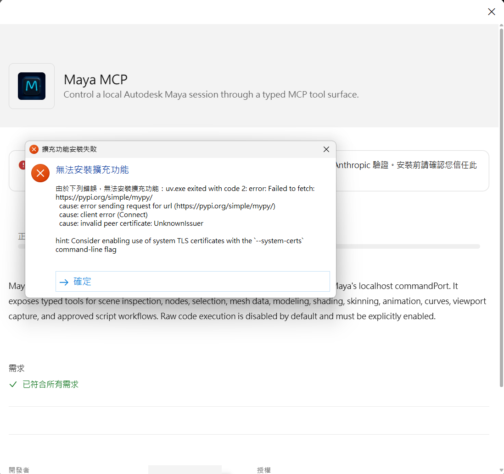
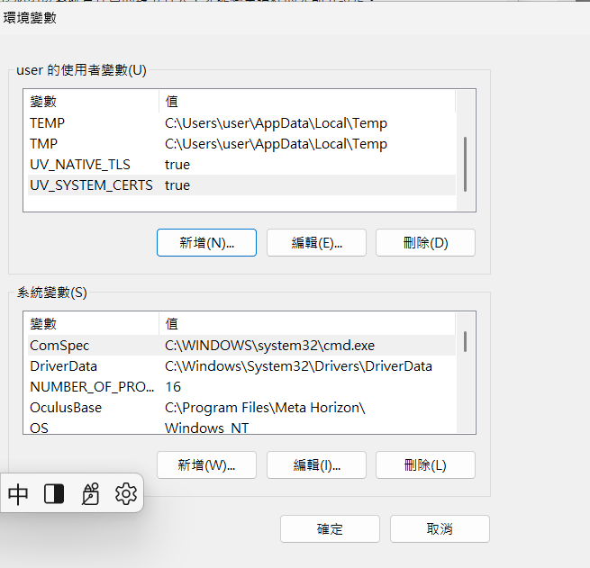
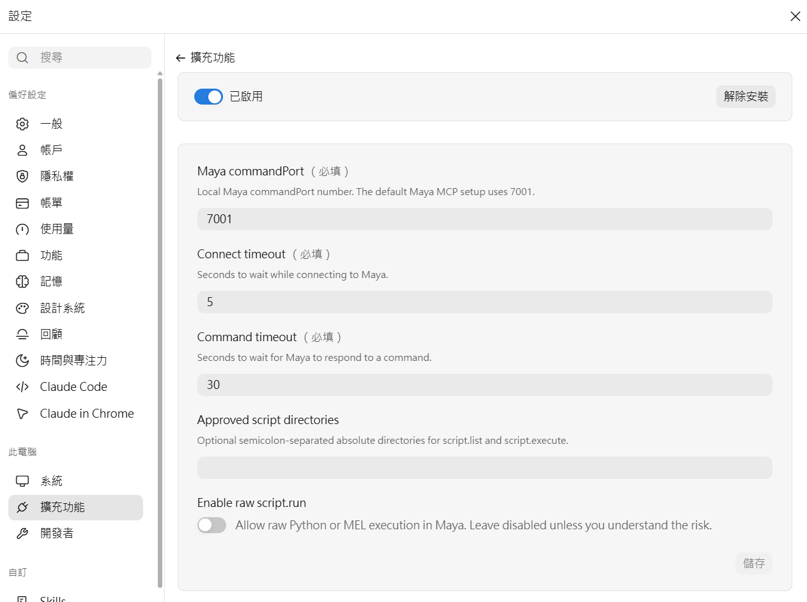
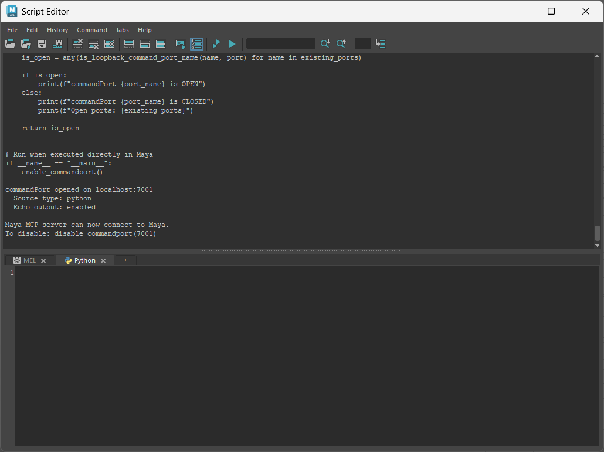

# Connecting Claude Desktop to Autodesk Maya with Maya MCP

A step-by-step tutorial for controlling Autodesk Maya from **Claude Desktop (Windows)** using the [GimbalGoats/GG_MayaMCP](https://github.com/GimbalGoats/GG_MayaMCP) extension.

Once it is set up, you can ask Claude in plain language to inspect your scene, create and edit objects, assign materials, set keyframes, capture the viewport and more.

> Tested with Maya MCP **0.6.1**, Claude Desktop on Windows 11 (Traditional Chinese UI), November 2026.

---

## How it works

```
Claude Desktop  ──(MCP)──▶  Maya MCP extension  ──(TCP localhost:7001)──▶  Maya commandPort
```

- **Claude Desktop** runs the Maya MCP server as an extension (`.mcpb` file).
- **Maya** opens a *commandPort* on `localhost:7001` so the server can send it commands.
- Both must run on the **same computer** and use the **same port number**.

---

## Contents

1. [Download the files](#1-download-the-files)
2. [Install the extension in Claude Desktop](#2-install-the-extension-in-claude-desktop)
3. [Fix: "invalid peer certificate: UnknownIssuer" install error](#3-fix-invalid-peer-certificate-unknownissuer-install-error)
4. [Configure and enable the extension](#4-configure-and-enable-the-extension)
5. [Open the commandPort in Maya](#5-open-the-commandport-in-maya)
6. [Test the connection](#6-test-the-connection)
7. [Using Maya MCP with Claude](#7-using-maya-mcp-with-claude)
8. [Day-to-day FAQ](#8-day-to-day-faq)
9. [Troubleshooting](#9-troubleshooting)

---

## 1. Download the files

From the [latest GG_MayaMCP release](https://github.com/GimbalGoats/GG_MayaMCP/releases/latest), download from **Assets**:

| File | What it's for |
|---|---|
| `maya-mcp-<version>.mcpb` | The Claude Desktop extension |
| `Source code (zip)` | Contains `scripts/enable_commandport.py`, which you run inside Maya |

Unzip the source code somewhere you'll remember (e.g. `Documents\GG_MayaMCP`).

> You do **not** need `pip install maya-mcp` for Claude Desktop. The `.mcpb` extension handles it. The pip steps in the upstream README are for other MCP clients.

---

## 2. Install the extension in Claude Desktop

Any one of these works:

- Double-click the `.mcpb` file, **or**
- Drag it into the Claude Desktop window, **or**
- **Settings (設定) → Extensions (擴充功能) → Advanced settings → Install Extension**

Claude Desktop will warn that the extension isn't verified by Anthropic. Install it only if you trust the source.

If the install succeeds, skip to [step 4](#4-configure-and-enable-the-extension). If you get a certificate error, read step 3.

---

## 3. Fix: "invalid peer certificate: UnknownIssuer" install error

During install, Claude Desktop uses `uv` to download Python packages from PyPI. On some machines the install fails with:

```
uv.exe exited with code 2: error: Failed to fetch: https://pypi.org/simple/mypy/
  cause: invalid peer certificate: UnknownIssuer
hint: Consider enabling use of system TLS certificates with the `--system-certs` command-line flag
```



**Why:** something on your network is inspecting HTTPS traffic, usually antivirus "HTTPS / web scanning" (Kaspersky, ESET, Avast, …) or a school/company proxy. Windows trusts its certificate, but `uv` only trusts its own bundled list.

**Fix:** tell `uv` to use the Windows certificate store.

1. Press **Win**, type `env`, open **Edit environment variables for your account** (編輯您帳戶的環境變數).
2. Under **User variables** (使用者變數), click **New** (新增) and add both:

   | Variable | Value |
   |---|---|
   | `UV_NATIVE_TLS` | `true` |
   | `UV_SYSTEM_CERTS` | `true` |

   

3. Click **OK** (確定) on every window to save.
4. **Fully quit Claude Desktop.** Right-click the Claude icon in the system tray and choose **Quit**. Closing the window is not enough; Claude only reads environment variables at startup.
5. Reopen Claude Desktop and install the `.mcpb` again.

**Still failing?** Temporarily turn off your antivirus's HTTPS scanning, or install while on a different network (e.g. a phone hotspot), then turn it back on.

---

## 4. Configure and enable the extension

After installing, Claude Desktop shows the extension settings:

| Setting | Recommended | Notes |
|---|---|---|
| Maya commandPort | `7001` | Must match the port opened in Maya |
| Connect timeout | `5` | Seconds |
| Command timeout | `30` | Seconds; raise it for heavy scenes |
| Approved script directories | *(empty)* | Optional; semicolon-separated folders for `script_list` / `script_execute` |
| Enable raw script.run | **Off** | Lets Claude run *any* Python/MEL in Maya. Leave off unless you need it |

Click **Save** (儲存), then make sure the toggle at the top says **Enabled** (已啟用). A freshly installed extension may start **Disabled** (已停用).



---

## 5. Open the commandPort in Maya

1. Start Maya **on the same computer**.
2. Open **Windows → General Editors → Script Editor**.
3. Click a **Python** tab (not MEL).
4. Open `scripts/enable_commandport.py` from the source zip, paste its full contents into the editor, and run it (**Ctrl+Enter** or the ▶ button).

You should see:

```
commandPort opened on localhost:7001
  Source type: python
  Echo output: enabled

Maya MCP server can now connect to Maya.
To disable: disable_commandport(7001)
```



Use the bundled script rather than writing your own `cmds.commandPort(...)` line. It handles a Maya 2024-specific response quirk and binds to localhost only.

### Optional: open the port automatically every time Maya starts

Copy `enable_commandport.py` into your Maya scripts folder:

```
C:\Users\<you>\Documents\maya\<version>\scripts\
```

Then create (or edit) `userSetup.py` in that same folder:

```python
import maya.utils

def _start_maya_mcp_port():
    import enable_commandport
    enable_commandport.enable_commandport()

maya.utils.executeDeferred(_start_maya_mcp_port)
```

Restart Maya. The Script Editor should print `commandPort opened on localhost:7001` on startup.

---

## 6. Test the connection

In Claude Desktop, ask:

> Run health_check, then scene_info.

A working connection returns something like:

```json
// health_check
{"status": "ok", "host": "localhost", "port": 7001, "last_contact": "..."}

// scene_info
{"file_path": null, "modified": false, "fps": 24.0, "frame_range": [0.0, 30.0], "up_axis": "y"}
```

> **Note:** the *very first* `health_check` may report `"status": "offline"` with `last_contact: null`. That only means nothing has connected yet. Run any other tool (like `scene_info`), then `health_check` again; it should say `ok`.

For a write test, use a throwaway scene and ask: *"Create a polygon cube."*

---

## 7. Using Maya MCP with Claude

Just describe what you want. Claude picks the right tools.

**Example prompts**

- "List everything in the scene."
- "Create a sphere and a cube, put the sphere on top of the cube."
- "Make a red lambert material and assign it to pCube1."
- "Bevel the edges of pCube1 and delete its history."
- "Key pSphere1's translateY at 0 on frame 1 and 5 on frame 24."
- "Capture the viewport so I can see what it looks like."
- "Save the scene as D:/projects/test.ma."

**Tool groups available**

| Group | Examples |
|---|---|
| Connection | `health_check`, `maya_connect`, `maya_disconnect` |
| Scene | `scene_info`, `scene_new`, `scene_open`, `scene_save`, `scene_save_as`, `scene_import`, `scene_export`, `scene_undo`, `scene_redo` |
| Nodes | `nodes_list`, `nodes_info`, `nodes_create`, `nodes_delete`, `nodes_duplicate`, `nodes_parent`, `nodes_rename` |
| Attributes & connections | `attributes_get`, `attributes_set`, `connections_list`, `connections_connect`, `connections_history` |
| Selection | `selection_get`, `selection_set`, `selection_clear`, component selection tools |
| Modeling | `modeling_create_polygon_primitive`, `modeling_extrude_faces`, `modeling_bevel`, `modeling_boolean`, `modeling_combine`, `modeling_insert_edge_loop`, `modeling_freeze_transforms`, … |
| Mesh & curves | `mesh_info`, `mesh_vertices`, `mesh_evaluate`, `curve_info`, `curve_cvs` |
| Shading | `shading_create_material`, `shading_assign_material`, `shading_set_material_color` |
| Skinning | `skin_bind`, `skin_unbind`, `skin_influences`, `skin_weights_get`, `skin_weights_set`, `skin_copy_weights` |
| Animation | `animation_set_keyframe`, `animation_get_keyframes`, `animation_delete_keyframes`, `animation_set_time`, `animation_set_time_range` |
| Viewport | `viewport_capture` |
| Scripts | `script_list`, `script_execute` (approved folders only), `script_run` (only if raw execution is enabled) |

**Safety notes**

- `scene_new` / `scene_open` refuse to discard **unsaved changes** by default. Save your work first.
- Keep **raw script.run off** unless you specifically need arbitrary code execution.
- Use `scene_undo` (or Ctrl+Z in Maya) if Claude does something you didn't want.

---

## 8. Day-to-day FAQ

**Do I need to run `enable_commandport.py` again when I open a new scene?**
No. The port belongs to the running Maya program, not the scene. It stays open when you open, create or switch scenes.

**When *do* I need to run it again?**
Only after you close and reopen Maya (unless you set up `userSetup.py`, see step 5).

**Do I need to start a new Claude chat after restarting Maya?**
No. Run the script in Maya, and the next request in any chat reconnects automatically. Any new chat also has the Maya tools while the extension is enabled.

**Can I use a different port?**
Yes, but change it in **both** places: the extension's *Maya commandPort* setting and the port opened in Maya.

---

## 9. Troubleshooting

| Symptom | Fix |
|---|---|
| Install fails with `invalid peer certificate: UnknownIssuer` | See [step 3](#3-fix-invalid-peer-certificate-unknownissuer-install-error) |
| Extension shows installed but failed / disabled | Turn the toggle on; check required settings are saved; fully quit and reopen Claude Desktop; toggle it under **Settings → Developer → Local MCP servers** |
| `health_check` fails or stays offline | Maya running on the same PC? Script run in a **Python** tab? Port matches (7001)? Restart Maya if the port seems stuck |
| Maya tools don't appear in Claude | Fully quit Claude Desktop from the system tray and reopen |
| Commands time out on big scenes | Increase *Command timeout* in the extension settings |

**Server log (Windows)**

```
%APPDATA%\Claude\logs\mcp-server-Maya MCP.log
```

Microsoft Store install:

```
%LOCALAPPDATA%\Packages\Claude_*\LocalCache\Roaming\Claude\logs\mcp-server-Maya MCP.log
```

---

## Credits

- Maya MCP by [GimbalGoats/GG_MayaMCP](https://github.com/GimbalGoats/GG_MayaMCP) (MIT License). See its [Claude Desktop extension guide](https://github.com/GimbalGoats/GG_MayaMCP/blob/main/docs/usage/claude-desktop-extension.md).
- This tutorial covers setup only; it is not affiliated with Autodesk, Anthropic, or GimbalGoats.
